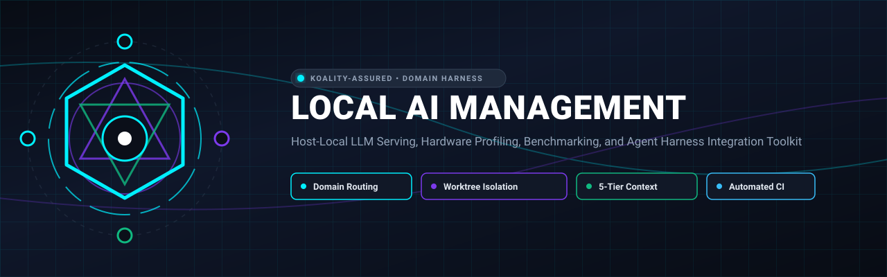
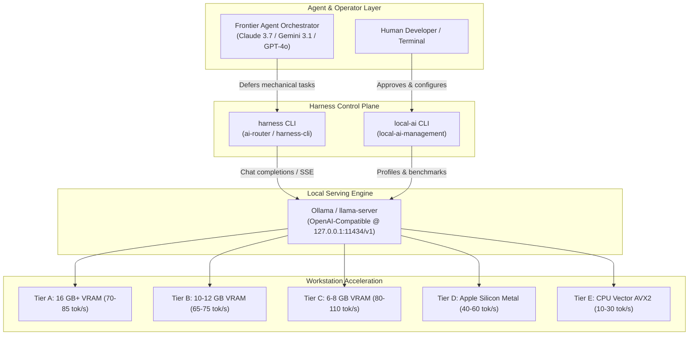

<div align="center">



# Local AI Management

<p align="center">
  
</p>

**Host-Local LLM Serving, Hardware Profiling, Benchmarking, and Agent Harness Integration Toolkit**

[](https://github.com/Koality-Assured/local-ai-management/actions/workflows/ci.yml)
[](LICENSE)
[](pyproject.toml)
[](#hardware-profiles)
[](https://conventionalcommits.org)

</div>

---

## Mission

`local-ai-management` delivers a production-grade, reproducible framework for standing up open-weight language models on developer workstations. It enables frontier AI agents (Claude 3.7 Sonnet, Gemini 3 Pro, GPT-4o) running in Antigravity, Cursor, and CLI harnesses to defer deterministic, mechanical, and high-volume tasks to local models at **$0.00 marginal cloud cost** with **sub-150ms latency**.

### Core Principles
- **Privacy First & Zero Exfiltration**: Inference runs 100% locally on host hardware (dedicated GPU VRAM, Apple Silicon unified memory, or CPU vector extensions). No code, tokens, or prompt snippets leave the developer machine.
- **Human Approval Gate**: Local AI model execution is strictly optional. Runtimes and multi-gigabyte model weights are **never automatically downloaded** without explicit human confirmation in that specific environment.
- **Dynamic Hardware Profiling**: System capabilities are inspected at runtime and mapped into standardized Hardware Profile Tiers (Tier A through Tier E), avoiding brittle hardcoded assumptions.
- **Empirical Grounding**: Model selection, throughput claims, and memory budgets are validated through a standardized benchmarking harness measuring Time-to-First-Token (TTFT), sustained tokens/sec, and task completion accuracy.

---

## Architecture Overview



---

## Hardware Profile Tiers

To guide model selection and memory budgeting across diverse development setups, workstations are classified into five standard tiers:

| Profile Tier | Hardware Baseline | System RAM & Memory Bandwidth | Target Models & Placement | Expected Throughput |
| :--- | :--- | :--- | :--- | :--- |
| **Tier A (High-Performance GPU)** | 16 GB+ VRAM (Ada / Ampere / RDNA3; ~700+ GB/s) | 64–128 GB DDR5 (~70–90 GB/s) | 14B Q4_K_M (100% VRAM); 32B hybrid offload | 14B: 70–85 tok/s<br>7B: 115–140 tok/s<br>32B: 14–18 tok/s |
| **Tier B (Standard Workstation GPU)** | 10–12 GB VRAM (RTX 4070 / 3080 class; ~500 GB/s) | 32–64 GB DDR4/DDR5 | 7B Q8_0 / 14B Q4_K_M (bounded context 8k–16k) | 14B: 65–75 tok/s<br>7B: 100–120 tok/s |
| **Tier C (Entry / Mobile GPU)** | 6–8 GB VRAM (RTX 4060 / Laptop class; ~280 GB/s) | 16–32 GB RAM | 7B Q4_K_M (100% VRAM) / 3B models | 7B: 80–110 tok/s<br>3B: 140+ tok/s |
| **Tier D (Unified Memory / Apple Silicon)** | 36–128 GB Unified Memory (M2/M3/M4 Pro/Max; ~150–400 GB/s) | Shared with OS | 14B–32B Q4_K_M / Q8_0 (Metal accelerated) | 14B: 40–60 tok/s<br>32B: 20–30 tok/s |
| **Tier E (CPU-Only / Vector Fallback)** | None / Integrated GPU | 32–128 GB DDR4/DDR5 (AVX2 / AVX-512) | 1.5B–7B quantized models (100% RAM) | 1.5B: 25–40 tok/s<br>7B: 8–15 tok/s |

See [`docs/hardware-profiles.md`](docs/hardware-profiles.md) for complete VRAM budget mathematics and Grouped Query Attention (GQA) KV cache scaling formulas.

---

## Evaluated Model Catalog

A machine-readable catalog is maintained in [`models/catalog.json`](models/catalog.json):

| Model | Parameters | Quantization | Size | Target Placement | HumanEval | Primary Role |
| :--- | :--- | :--- | :--- | :--- | :--- | :--- |
| **Qwen 2.5 Coder 14B Instruct** | 14.7B | Q4_K_M | 8.98 GB | 100% VRAM (Tier A/B) | 86.6% | **Primary Coding Workhorse**: Code generation, refactoring, AST transforms. |
| **Qwen 2.5 Coder 7B Instruct** | 7.6B | Q4_K_M | 4.68 GB | 100% VRAM (Tier A–C) | 82.3% | **High-Velocity Deferral**: Linter fixes, boilerplate, commit messages (>115 tok/s). |
| **DeepSeek-R1-Distill-Qwen-14B** | 14.7B | Q4_K_M | 8.98 GB | 100% VRAM (Tier A/B) | 93.9% (MATH) | **Deep Reasoning**: Architecture planning, complex regex synthesis, debugging. |
| **Llama 3.1 8B Instruct** | 8.0B | Q4_K_M | 4.92 GB | 100% VRAM (Tier A–C) | 72.6% | **Generalist / Tool-Use**: JSON extraction, classification, general NLP. |
| **Qwen 2.5 Coder 32B Instruct** | 32.5B | Q4_K_M | 19.8 GB | Hybrid (GPU + RAM) | 92.7% | **Frontier-Level Coding**: Autonomous multi-file module scaffolding. |
| **Qwen 2.5 Coder 1.5B Instruct** | 1.54B | Q4_K_M | 1.10 GB | 100% RAM (Tier E) | 65.2% | **CPU Fallback**: Ultra-fast lightweight transformations on CPU. |
| **Nomic Embed Text v1.5** | 137M | FP16 | 0.56 GB | 100% VRAM | 62.28 (MTEB)| **Local Embeddings**: High-speed semantic search & RAG routing. |

---

## Quickstart & CLI Usage

### Installation

```bash
# Clone the repository
git clone https://github.com/Koality-Assured/local-ai-management.git
cd local-ai-management

# Install locally in editable mode
pip install -e .

# Run test suite
python -m unittest discover tests
```

### CLI Commands

#### 1. Hardware Profiling
Detect host CPU, system RAM, and GPU VRAM, and map into the appropriate profile tier:
```bash
local-ai profile
local-ai profile --json
```

#### 2. Model Catalog Inspection
Query and filter evaluated open-weight models:
```bash
local-ai catalog
local-ai catalog --tier "Tier A"
local-ai catalog --id qwen2.5-coder:14b
```

#### 3. Empirical Benchmarking
Run standardized empirical benchmarks across code generation, structured JSON extraction, refactoring, and logical reasoning:
```bash
# Live run against local Ollama / llama-server
local-ai benchmark --model qwen2.5-coder:14b

# Run across multiple models
local-ai benchmark --models qwen2.5-coder:14b,qwen2.5-coder:7b

# Offline / Mock mode for CI and headless testing
local-ai benchmark --mock --json
```

#### 4. Safe Onboarding (Human Approved)
Probe hardware capabilities and guide local AI environment setup:
```bash
# Inspect capabilities only (safe probe, no prompts)
local-ai onboard --profile-only

# Require explicit human approval
local-ai onboard

# Proceed with approved onboarding
local-ai onboard --approve
```

#### 5. Modelfile & Launch Command Synthesis
Generate optimized Modelfiles with tailored parameters and system prompts:
```bash
local-ai modelfile --model qwen2.5-coder:14b --context 32768
local-ai modelfile --model ./models/qwen.gguf --engine llama-server --context 16384
```

---

## Repository Documentation

- [`docs/hardware-profiles.md`](docs/hardware-profiles.md): Detailed tier definitions, VRAM math, and memory allocation diagrams.
- [`docs/serving-engines.md`](docs/serving-engines.md): Step-by-step setup recipes for Ollama, `llama-server`, FlashAttention-2, and quantized KV caching.
- [`docs/frontier-deferral.md`](docs/frontier-deferral.md): Task suitability taxonomy, harness CLI routing, and token economy ROI.
- [`docs/benchmarking-methodology.md`](docs/benchmarking-methodology.md): Rigorous benchmarking protocol for TTFT, tokens/sec, and correctness validation.

---

## License

Licensed under the Apache License, Version 2.0. See [LICENSE](LICENSE) for details.
