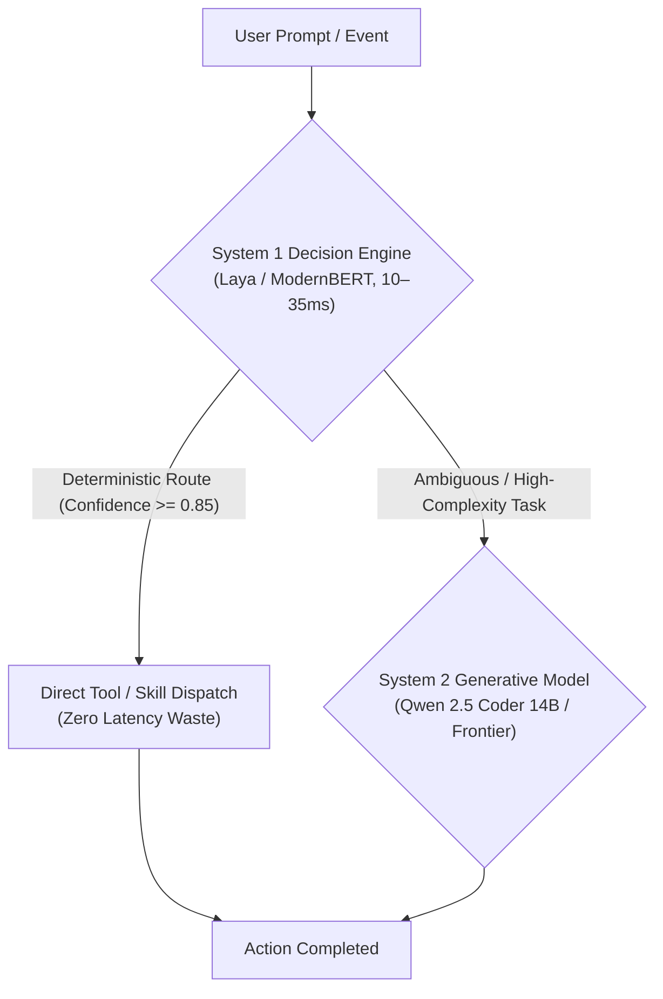

# System One Decision Models: Fast Non-Autoregressive Routing & Triage

An engineering guide to deploying and benchmarking non-autoregressive "System 1" decision models locally. Covers Kahneman's dual-process architecture, proprietary Jev vs. open-source Laya, question primitives, and integration patterns for local agent workflows.

---

## 1. Dual-Process Cognitive Architecture for AI Agents

In cognitive psychology (Daniel Kahneman, *Thinking, Fast and Slow*), human cognition operates in two modalities:
- **System 1**: Fast, automatic, intuitive, low-latency, subconscious.
- **System 2**: Slow, deliberate, logical, effortful, analytical.

Modern LLMs (Claude, GPT, DeepSeek, Qwen) operate primarily as **System 2** generative engines. When an agent invokes a 14B or 70B parameter model merely to classify an intent, route to a skill, or check if an action is safe, it pays a huge latency penalty (1,500ms–5,000ms), consumes large token budgets, and risks hallucination or formatting drift.

**System 1 decision models** discard autoregressive token-by-token generation in favor of a single forward pass that outputs structured, typed decisions and calibrated probabilities in **10–50ms**.



---

## 2. Proprietary Baseline vs. Open-Source Ecosystem

### 2.1 TypeSafe AI's Jev
Introduced in September 2026, **Jev** was the first commercial System 1 decision model. Designed as a "smart if-statement" for software engineering, Jev provides a `POST /v1/systemone` endpoint accepting:
- `state`: Arbitrary text, ticket, diff, or JSON log.
- `questions`: Typed schema definitions for decisions.

### 2.2 Open-Source Alternative: Laya (Convai Innovations)
**Laya** is an Apache 2.0 open-weights decision model engineered as a direct, self-hostable alternative to Jev:
- **Architecture**: ModernBERT-large (421M parameters).
- **Latency**: ~33ms on Nvidia T4; **12–20ms** on modern GPUs; **35–50ms** on CPU via ONNX Runtime (`receptron/laya`).
- **Compatibility**: Exposes `laya-serve`, providing drop-in compatibility with Jev's `POST /v1/systemone` endpoint.
- **Package**: Available via `pip install laya`.

### 2.3 Additional Open-Source System 1 Options
- **ModernBERT-base Classifier (149M)**: Native 8,192 context window, sub-10ms classification on GPU, ideal for inline guardrails and taint analysis.
- **Grammar-Constrained SLMs (Qwen2.5-0.5B / SmolLM2-360M)**: Using llama.cpp grammar or Outlines to constrain output to a single enum token ($T=1$), achieving 30–50ms response times inside standard Ollama/llama.cpp runtimes.

---

## 3. Decision Primitives

System 1 models support three core question primitives:

| Primitive | Purpose | Example Question | Output Structure |
| :--- | :--- | :--- | :--- |
| **`choice`** | Pick exactly one option from a map | `"target_skill": { "type": "choice", "criteria": { "refactor": "...", "test": "..." } }` | `{"answer": "refactor", "confidence": 0.94}` |
| **`noul`** | Calibrated boolean assessment (No / Yes / Uncertain) | `"is_mutating": { "type": "noul", "instructions": "Does this edit files?" }` | `{"answer": "yes", "confidence": 0.98, "p_true": 0.98}` |
| **`score`** | Ordered rubric rating | `"complexity": { "type": "score", "instructions": "Complexity 1-5" }` | `{"score": 2.4, "variance": 0.12}` |

---

## 4. Primary Use Cases in Local Agent Stacks

1. **Sub-50ms Skill Dispatch & Routing**:
   - Classify incoming prompts into catalog skills before allocating context to frontier models.
2. **Deterministic Mutation & Isolation Gating**:
   - `noul` check: `is_mutating` determines whether to provision an isolated worktree.
3. **Inline Security Guardrails**:
   - Rapid classification of tool outputs for prompt injection or leaked credentials in <10ms.
4. **Local Deferral Tier Filtering**:
   - Classify whether a code task is suitable for a local 7B/14B model or requires frontier System 2 reasoning.
5. **RAG Semantic Re-ranking**:
   - Cross-encoder validation of retrieved chunks before context assembly.

---

## 5. Benchmarking System 1 Models

The `local-ai` CLI includes a dedicated `system_one` benchmark suite testing:
- **Decision Latency (TTFT / Total Time)**: Sub-50ms target.
- **Schema Adherence**: 100% typed output without markdown parsing errors.
- **Confidence Calibration**: Well-calibrated probabilities for reliable branching.

Run the benchmark suite:
```bash
local-ai benchmark --suite system_one --mock
```
